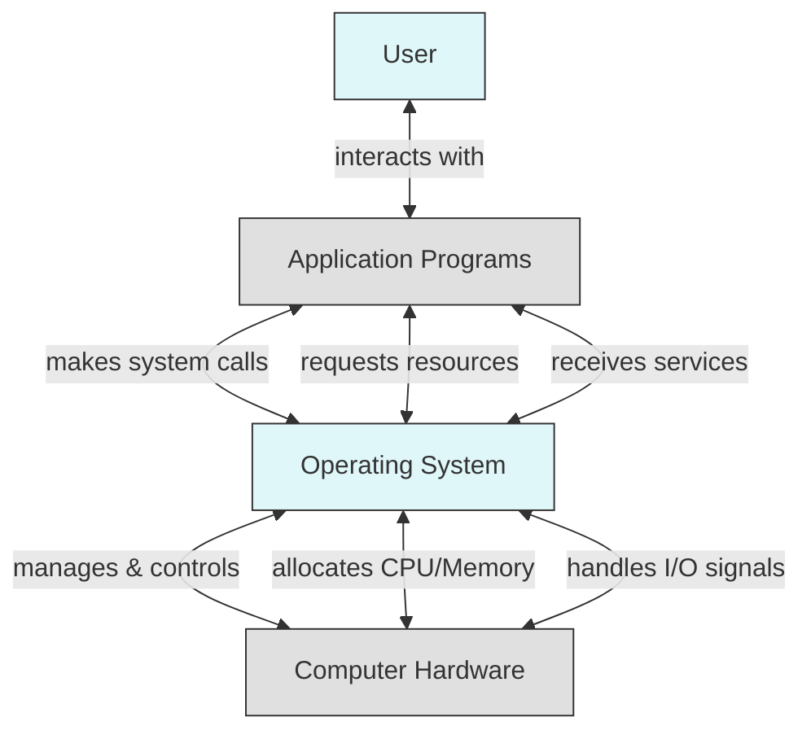

---
tags:
  - operating-system
  - lecture-notes
sources:
  - "[[week01-ch1.pdf]]"
  - "[[ch2.pdf]]"
---
## Overview and Foundations of Operating Systems
---
### What even is it?

**Operation** means action, process, or way of functioning, and **Systems** mean set of connected or interacting elements. In simpler term, **Operating System (OS)** is a program that acts as an intermediary between a user of a computer and the computer hardware. It functions as a bridge between users and the actual machine living inside the computer.

OS exists to execute user programs and make solving user problems easier, make the computer system convenient to use, and use the computer hardware in an efficient way.

### What is a computer system made up of?

To understand OS further, we must first know what are we dealing with. A computer system can be divided into four components:
- **Hardware**: Basic computing resources (CPU, memory, I/O Devices)
- **Operating System**: Controls and coordinates the resources usages among programs
- **Application Programs**: Ways to perform specific tasks and solve problems
- **Users**: Anything that interacts with computer. 

### What does OS even do?

OS has many uses, depends on what the users actually need. ***The role of OS changes depending on the type of system and who or what is using it.***

- **User Perspective**
	Individual users care about **convenience, ease of use, and fast performance**. They generally don't care how efficiently system resources (CPU, RAM) are being utilized.
- **Shared Systems**
	OS acts primarily as a **resource allocator** and a **control program**.
- **Workstations**
	Workstations give individual users **dedicated resources** while simultaneously connecting to **shared server resources**.
- **Mobile Devices**
	Their OS is optimized for **usability, touch interaction, voice recognition, and power management**.
- **Embedded Computers**
	The OS is designed to run automatically **without user intervention**.

>[!question]- What is the primary role of an operating system?
>The primary function of an operating system is to manage hardware and software resources on a computer.

>[!question]- How does OS differs from an individual user and on a shared system perspectives?
>**Individual users** prioritize convenience, ease of use, and fast performance, whereas on **shared systems**, the OS acts primarily as a resource allocator and control program.

## Computer-System Organization and Hardware Interaction
---

### How does these Computer-System work together?

With CPUs, device controllers connect through common **bus** providing access to shared memory. I/O devices and the CPU can execute concurrently with the device controller informing the CPU with **interrupt**. Each device controller type has a device driver to manage it. These device driver serves as the **bridge between OS and device controller**.

### What are Interrupts?

These **interrupts** are special signal sent from a hardware devices to inform the CPU that certain tasks need to be done and temporarily pauses current execution to handle the high-priority request. The current process state are saved onto a stack or **Program Control Block**.

These interrupts transfers control to the **Interrupt Service Routines (ISR)** through **Interrupts Vector**.

![[Interrupt Timeline.png]]

From the diagram, we can breakdown step by step on how the CPU and I/O device run concurrently. First, the user program send an I/O request via *trap* to the device controller. The I/O device transitions from idle to transferring, and the CPU immediately goes back to executing the user program. After the device finish transferring the data, it sent a interrupt signal to the CPU. After receiving the signal, CPU pauses the current process and handles the interrupt routine. Once the handler finishes processing the data, execution drops back up to resume the user program.

###

